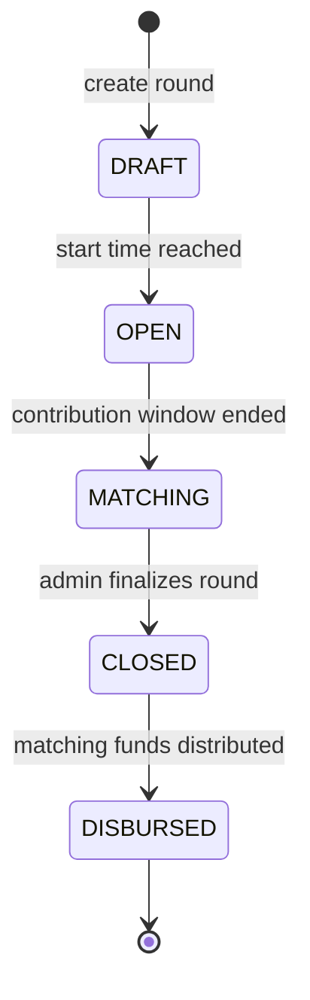

# Grant round lifecycle

Grant rounds use one backend state machine:

Only the transitions shown above are legal. The canonical transition table and
validator live in `apps/backend/src/grants/round-lifecycle.ts`; invalid state
operations return the same `400 Bad Request` message:
`Invalid grant round state transition`.

`GrantsService` advances scheduled `DRAFT -> OPEN` and `OPEN -> MATCHING`
states whenever a round is read or modified. `finalizeRound` closes a matching
round, and `distribute` marks a closed round as disbursed only after a valid
allocation is computed. A failed transition does not update the round.

The API's `status` field returns one of the five state names. The legacy
`isFinalized` and `isDistributed` response fields remain available and are
derived from the canonical state.

This state machine covers backend grant rounds. Crowdfund project statuses and
Soroban contract round state are separate models; the backend's contract admin
service submits contract operations but does not maintain a second backend
round lifecycle.
